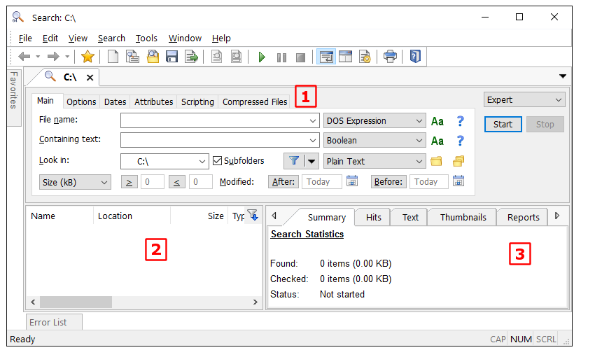
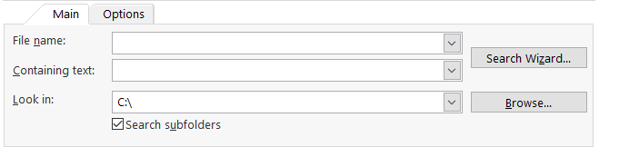
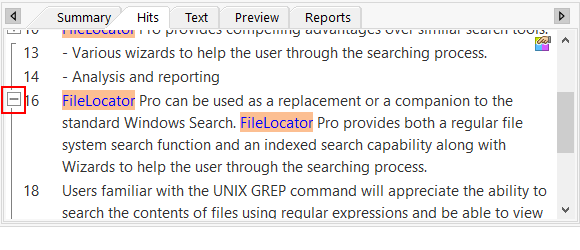

# Agent Ransack - File And Content Search For Windows

Agent Ransack Lite maintains the Agent Ransack repository as a curated Windows search code study. Agent Ransack performs real-time filename and content searches without requiring a persistent background index.

## Overview

Agent Ransack software searches filenames and text stored inside documents, source code, logs, spreadsheets, local disks, and network shares. Agent Ransack Lite is free for personal and commercial use and shares its search engine lineage with FileLocator Pro.

Agent Ransack content search evaluates files in real time. This no-indexing approach avoids maintaining a persistent search database, although uncached searches can be slower than indexed filename searches.

### Search Scope

agent ransack, agent ransack lite, agent ransack file search, agent ransack content search, agent ransack regex search, file-search, content-search, text-search, regex-search, windows-search, desktop-search, no-indexing, network-shares

## Features

- **Agent Ransack file search:** Selects files by name, folder, extension, date, size, and other available criteria.
- **Agent Ransack text search:** Finds matching text inside supported files instead of checking filenames alone.
- **Agent Ransack search inside files:** Examines documents, code, logs, and spreadsheets without opening every result manually.
- **Agent Ransack regex search:** Supports Perl-compatible regular-expression queries for precise matching.
- **Agent Ransack boolean search:** Combines terms with AND, OR, and NOT conditions.
- **Agent Ransack search for multiple words:** Supports queries that require, permit, or exclude multiple terms.
- **Agent Ransack wildcard:** Narrows file and folder selections with wildcard expressions.
- **Live preview:** Displays matching lines and highlighted terms before a file is opened.
- **Network searching:** Extends real-time searches to accessible network shares and mapped drives.
- **No background indexing:** Searches current filesystem contents without continuously maintaining an index database.
- **Windows integration:** Provides native Windows dialogs, shell integration, bookmarks, settings, and reusable queries.
- **Localization:** Includes retained language resources for several interface languages.

### What is Agent Ransack used for?

Agent Ransack is used to locate files and find text contained inside them. A user can search a directory tree for an exact phrase, a regular expression, several Boolean terms, or files matching selected wildcard rules.

Agent Ransack content search is useful when filenames do not reveal which document contains the required information. Developers can inspect source trees and logs, administrators can search configuration files and network shares, and office users can locate text in supported documents and spreadsheets.

Agent Ransack Lite also provides result previews, allowing users to inspect matching context before opening a file. This makes Agent Ransack file search suitable for investigations involving many similarly named files.

## Why use Agent Ransack?

- Agent Ransack searches current filesystem content instead of relying on a potentially stale persistent index.
- Agent Ransack regex search provides more control than a basic Windows filename query.
- Agent Ransack boolean search supports compound conditions without requiring a command-line pipeline.
- Agent Ransack Lite permits commercial use as well as personal use.
- Agent Ransack search network drives applies the same workflow to accessible shares.
- Agent Ransack windows 10 and agent ransack windows 11 searches use a desktop interface designed for Windows.
- Agent Ransack 64 bit operation is appropriate for modern 64-bit Windows environments when the corresponding build is used.

## Search Modes

| Mode | Purpose |
|---|---|
| Filename | Finds files and folders from names, paths, wildcards, and metadata constraints. |
| Text | Finds literal words and phrases inside supported files. |
| Regular expression | Applies Perl-compatible patterns to file content. |
| Boolean | Combines required, optional, and excluded terms. |
| Preview | Shows matching text and surrounding context with highlights. |
| Network share | Searches accessible remote paths without creating a local content index. |

The retained implementation includes query handling in [`src/query.cpp`](src/query.cpp), glob processing in [`src/glob.cpp`](src/glob.cpp), search state in [`src/SearchInfo.cpp`](src/SearchInfo.cpp), and the primary search dialog in [`src/SearchDlg.cpp`](src/SearchDlg.cpp).

### Is agent Ransack safe?

Users should obtain releases through the Agent Ransack official site or another trusted distribution channel, verify the publisher and digital signature, and scan the package according to their organization’s security policy.

The retained Agent Ransack repository contains inspectable C++ source, installer definitions, a shell integration component, and automated security analysis configuration. Relevant files include [`src/ShellContextMenu.cpp`](src/ShellContextMenu.cpp), [`src/ExplorerCommandVerb/dllmain.cpp`](src/ExplorerCommandVerb/dllmain.cpp), [`src/Setup/CustomActions/CustomActions.cpp`](src/Setup/CustomActions/CustomActions.cpp), and [`.github/workflows/codeql.yml`](.github/workflows/codeql.yml).

Shell extensions and installer custom actions execute within security-sensitive Windows contexts, so they deserve particular review.

## Privacy Policy

Agent Ransack performs local and network-share searches selected by the user. Searching a network path necessarily communicates with the system hosting that path.

Users should review application settings, update behavior, network activity, and the privacy terms accompanying their specific distribution.

## Code Signing Policy

Release packages should be signed by their expected publisher. A valid signature establishes package integrity and publisher identity.

The retained tree includes Windows manifests and installer definitions. The relevant retained files include [`src/compatibility.manifest`](src/compatibility.manifest), [`src/Setup/AppXManifest.xml.in`](src/Setup/AppXManifest.xml.in), and [`src/Setup/Setup.wxs`](src/Setup/Setup.wxs).

## How to install

Agent Ransack portable availability and installer behavior depend on the selected distribution. The retained repository contains Windows installer material.

After obtaining a trusted package, verify its publisher, select the required architecture, and follow the Windows installation prompts. Administrative approval may be required for shell integration or machine-wide installation.

### Is agent Ransack free?

Agent Ransack Lite is free for personal and commercial use. This makes Agent Ransack commercial use possible without purchasing a Pro license for the Lite feature set.

A paid FileLocator Pro license can unlock the corresponding professional feature set in the shared product family.

## Current Limitations

- Real-time content searches can be slower than indexed filename lookup, especially on cold storage, large directory trees, or network shares.
- Unsupported or encrypted document formats may not expose searchable text.
- Permissions can prevent Agent Ransack from reading protected files or remote paths.
- Regular expressions can become expensive when patterns contain broad repetition or little literal text.
- Agent Ransack portable packaging is not represented in the retained files.
- The selected repository contains no dedicated retained unit-test or fuzz-test project.

### What are some alternatives to Agent Ransack?

Everything is a strong alternative when the primary requirement is extremely fast filename lookup through filesystem indexing. It is generally better suited to locating a known filename, while Agent Ransack content search is aimed at inspecting file contents in real time.

DnGrep and grepWin provide Windows desktop workflows for text and regular-expression searches. GrepWin also emphasizes search and replacement, while dnGrep supports several document and archive formats.

Ripgrep and ugrep are substantial command-line alternatives. Ripgrep emphasizes fast recursive source searches and automatic ignore handling. Ugrep adds Boolean queries, interactive searching, fuzzy matching, archive support, multiple encodings, and structured output.

FSearch is an indexed Linux filename-search application. Sist2 and DocFetcher are better suited to indexed document collections where repeated searches justify maintaining an index. The best alternative depends on whether filename speed, deep content inspection, replacement, command-line automation, or indexed document retrieval is the primary requirement.

## Command line parameters

The source material describes command-line entry points as useful for repeatable searches and automation. The retained Agent Ransack repository does not include a complete command-line reference, so undocumented switches should not be inferred.

Argument processing begins in [`src/grepWin.cpp`](src/grepWin.cpp), while search criteria are represented by [`src/SearchInfo.h`](src/SearchInfo.h). Confirm supported parameters against the exact build before using them in scripts.

## Bookmarks And Settings

Reusable searches are represented by the bookmark implementation in [`src/Bookmarks.cpp`](src/Bookmarks.cpp) and its dialog in [`src/BookmarksDlg.cpp`](src/BookmarksDlg.cpp). Persistent application options are implemented in [`src/Settings.cpp`](src/Settings.cpp).

The retained interface also includes dedicated dialogs for regular-expression testing, multiline input, names, and newline handling:

- [`src/RegexTestDlg.cpp`](src/RegexTestDlg.cpp)
- [`src/MultiLineEditDlg.cpp`](src/MultiLineEditDlg.cpp)
- [`src/NameDlg.cpp`](src/NameDlg.cpp)
- [`src/NewlinesDlg.cpp`](src/NewlinesDlg.cpp)

## Build from source

The retained Agent Ransack project is primarily C++ and targets Windows with MSVC.

### Using Microsoft Visual Studio

1. Use a Visual Studio installation that supports the retained solution and C++ desktop projects.
2. Open [`grepWin.slnx`](grepWin.slnx).
3. Restore dependencies described by [`vcpkg.json`](vcpkg.json) and [`src/packages.config`](src/packages.config).
4. Select the required Windows platform and build configuration.
5. Build the solution containing [`src/grepWin.vcxproj`](src/grepWin.vcxproj).
6. Build installer components only when the required Windows packaging workload is available.

The automated Windows build definition is available in [`.github/workflows/msbuild.yml`](.github/workflows/msbuild.yml). Release automation is defined in [`.github/workflows/release.yml`](.github/workflows/release.yml).

## Layout

| Path | Purpose |
|---|---|
| [`src/grepWin.cpp`](src/grepWin.cpp) | Application entry point and command-line processing. |
| [`src/SearchDlg.cpp`](src/SearchDlg.cpp) | Main search interface and orchestration. |
| [`src/query.cpp`](src/query.cpp) | Query processing. |
| [`src/glob.cpp`](src/glob.cpp) | Wildcard and path matching. |
| [`src/RegexReplaceFormatter.cpp`](src/RegexReplaceFormatter.cpp) | Regular-expression replacement formatting. |
| [`src/Theme.cpp`](src/Theme.cpp) | Interface theme handling. |
| [`src/ShellContextMenu.cpp`](src/ShellContextMenu.cpp) | Windows shell integration. |
| [`src/ExplorerCommandVerb/ExplorerCommandVerb.vcxproj`](src/ExplorerCommandVerb/ExplorerCommandVerb.vcxproj) | Explorer command component. |
| [`src/Setup/Setup.wxs`](src/Setup/Setup.wxs) | Windows installer definition. |
| [`translations/German.lang`](translations/German.lang) | German interface resource associated with agent ransack deutsch interest. |
| [`CHANGELOG.md`](CHANGELOG.md) | Agent Ransack version history for this repository. |

## Translate

Agent Ransack Lite retains English, French, German, Italian, Japanese, Korean, Polish, Portuguese, and Spanish language resources. Contributors should update the appropriate `.lang` file while preserving keys and placeholders.

Examples include [`translations/English.lang`](translations/English.lang), [`translations/French.lang`](translations/French.lang), [`translations/German.lang`](translations/German.lang), and [`translations/Spanish.lang`](translations/Spanish.lang).

## Development roadmap

- Improve Agent Ransack text search responsiveness on large directory trees.
- Preserve cancellation and interface responsiveness during long searches.
- Strengthen wildcard, Boolean, and regular-expression validation.
- Expand automated testing around malformed patterns and unusual paths.
- Review shell integration, installer actions, and path handling.
- Document Agent Ransack search for multiple words with reproducible examples.
- Keep Agent Ransack version history synchronized with [`version.txt`](version.txt) and [`CHANGELOG.md`](CHANGELOG.md).

The comparative source projects emphasize regression corpora, sanitizers, fuzzing, encoding tests, archive tests, and reproducible performance measurements. Those practices are appropriate future quality goals.

## Troubleshooting

- Confirm that the selected directory exists and is readable.
- Reduce the search scope when Agent Ransack search network drives is limited by latency.
- Test complicated expressions before applying them to a large directory tree.
- Check wildcard exclusions when expected files are missing.
- Confirm the document format exposes text rather than scanned images.
- Use a matching architecture when investigating agent ransack 64 bit issues.
- Review [`src/RegexTestDlg.cpp`](src/RegexTestDlg.cpp) when debugging expression handling.
- Review [`src/SearchDlg.cpp`](src/SearchDlg.cpp) and [`src/SearchInfo.cpp`](src/SearchInfo.cpp) when debugging search criteria.

## Vulnerability reporting

Do not publish sensitive vulnerability details in a general feature request. Use the retained [bug report template](.github/ISSUE_TEMPLATE/bug_report.yml) to provide a minimal reproducer, affected version, architecture, and observed behavior without including confidential files.

Potential memory-safety issues in path parsing, regular-expression formatting, shell integration, or installer custom actions should identify the triggering input and the affected component without claiming code execution unless evidence establishes it.

## Questions?

Use the [feature request template](.github/ISSUE_TEMPLATE/feature_request.md) for proposed changes. Read [`CONTRIBUTING.md`](CONTRIBUTING.md), [`CODE_OF_CONDUCT.md`](CODE_OF_CONDUCT.md), and the [pull request template](.github/pull_request_template.md) before submitting changes to Agent Ransack Lite or the Agent Ransack repository.

## License

[`LICENSE`](LICENSE)
